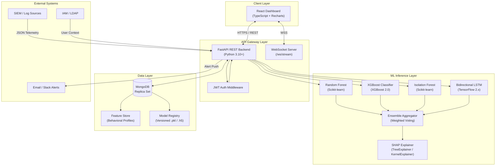
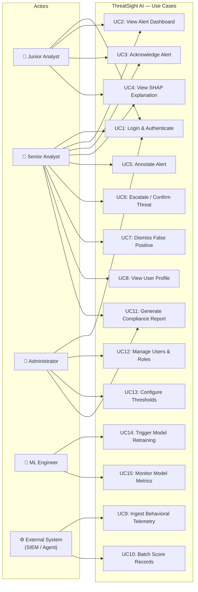
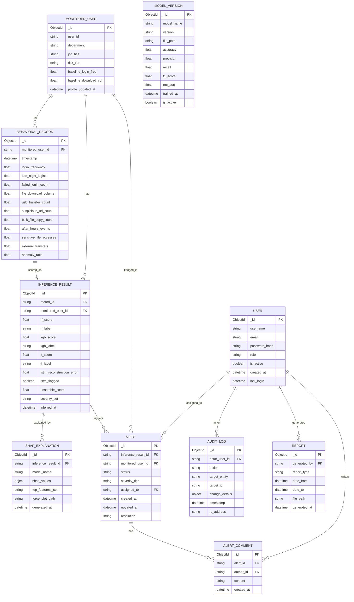

# Software Requirements Specification
## ThreatSight AI: Explainable Insider Threat Intelligence Platform Using User Behavior Analytics and Machine Learning

---

**Document Version:** 1.0  
**Date:** May 25, 2026  
**Status:** Final  
**Prepared By:** ThreatSight AI Development Team  
**IEEE Standard:** IEEE Std 830-1998  

---

## Table of Contents

1. [Introduction](#1-introduction)
   - 1.1 Purpose
   - 1.2 Scope
   - 1.3 Definitions, Acronyms, and Abbreviations
   - 1.4 References
   - 1.5 Overview
2. [Overall Description](#2-overall-description)
   - 2.1 Product Perspective
   - 2.2 Product Functions
   - 2.3 User Characteristics
   - 2.4 Constraints
   - 2.5 Assumptions and Dependencies
3. [Specific Requirements](#3-specific-requirements)
   - 3.1 Functional Requirements
   - 3.2 Non-Functional Requirements
4. [System Models](#4-system-models)
   - 4.1 System Architecture Diagram
   - 4.2 Use Case Diagram
   - 4.3 Database Schema (ER Diagram)
5. [Appendices](#5-appendices)

---

## 1. Introduction

### 1.1 Purpose

This Software Requirements Specification (SRS) document defines the complete functional and non-functional requirements for **ThreatSight AI**, an Explainable Insider Threat Intelligence Platform employing User Behavior Analytics (UBA) and Machine Learning (ML). This document is intended for use by software architects, developers, system engineers, quality assurance teams, project managers, and organizational security stakeholders who will participate in the design, implementation, testing, and deployment of the platform.

The purpose of ThreatSight AI is to provide organizations with a proactive, data-driven mechanism for detecting insider threats — malicious or negligent behaviors originating from within an organization's trusted network perimeter. By combining behavioral analytics with ensemble machine learning models and Explainable AI (XAI) techniques, ThreatSight AI enables security analysts to not only detect anomalous behaviors but also understand the rationale behind each detection alert. This document establishes the requirements baseline against which the final product shall be verified and validated.

### 1.2 Scope

**ThreatSight AI** is a full-stack web-based security intelligence platform. The system ingests user behavioral telemetry data — derived from endpoint activity logs, authentication records, network traffic summaries, and file system events — and applies multiple machine learning models to identify insider threat activity in real time or near-real time.

The platform encompasses:

- A **FastAPI-based REST API backend** that orchestrates data ingestion, ML inference, and result storage.
- A **React-based frontend dashboard** providing security analysts with visual threat intelligence, alert management, and SHAP-driven explainability reports.
- A **MongoDB document store** for persisting user behavioral profiles, detection results, and audit logs.
- An **ML inference pipeline** incorporating Random Forest, XGBoost, Isolation Forest, and LSTM models trained on the CERT Insider Threat Dataset r4.2.
- A **SHAP explainability module** that provides per-prediction feature importance explanations for every ML inference.

The platform is designed for deployment within enterprise security operations centers (SOCs) and will interface with existing Security Information and Event Management (SIEM) systems, Identity and Access Management (IAM) platforms, and endpoint monitoring agents. ThreatSight AI does **not** replace human analysts; instead, it augments their capabilities with algorithmic intelligence and interpretable decision support.

### 1.3 Definitions, Acronyms, and Abbreviations

| Term / Acronym | Definition |
|---|---|
| **AI** | Artificial Intelligence |
| **API** | Application Programming Interface |
| **AUC** | Area Under the Receiver Operating Characteristic Curve |
| **CERT** | Computer Emergency Response Team |
| **CRUD** | Create, Read, Update, Delete |
| **DBA** | Database Administrator |
| **EDR** | Endpoint Detection and Response |
| **FP** | False Positive |
| **FN** | False Negative |
| **FR** | Functional Requirement |
| **IAM** | Identity and Access Management |
| **IEEE** | Institute of Electrical and Electronics Engineers |
| **IF** | Isolation Forest |
| **IoC** | Indicator of Compromise |
| **JWT** | JSON Web Token |
| **LDAP** | Lightweight Directory Access Protocol |
| **LSTM** | Long Short-Term Memory (neural network) |
| **ML** | Machine Learning |
| **MTTD** | Mean Time to Detection |
| **NFR** | Non-Functional Requirement |
| **RBAC** | Role-Based Access Control |
| **RF** | Random Forest |
| **REST** | Representational State Transfer |
| **ROC** | Receiver Operating Characteristic |
| **SHAP** | SHapley Additive exPlanations |
| **SIEM** | Security Information and Event Management |
| **SOC** | Security Operations Center |
| **SRS** | Software Requirements Specification |
| **SSL/TLS** | Secure Sockets Layer / Transport Layer Security |
| **TP** | True Positive |
| **UBA** | User Behavior Analytics |
| **XAI** | Explainable Artificial Intelligence |
| **XGBoost** | eXtreme Gradient Boosting |

### 1.4 References

1. IEEE Std 830-1998, *IEEE Recommended Practice for Software Requirements Specifications*.
2. CERT Division, Carnegie Mellon University, *CERT Insider Threat Dataset r4.2*, 2016.
3. Lundberg, S. M., & Lee, S. I. (2017). *A Unified Approach to Interpreting Model Predictions*. NeurIPS.
4. Chen, T., & Guestrin, C. (2016). *XGBoost: A Scalable Tree Boosting System*. KDD.
5. Liu, F. T., Ting, K. M., & Zhou, Z. H. (2008). *Isolation Forest*. ICDM.
6. NIST SP 800-53 Rev. 5, *Security and Privacy Controls for Information Systems and Organizations*.
7. OWASP Top Ten, 2021 Edition.

### 1.5 Overview

The remainder of this SRS is organized as follows. Section 2 provides an overall description of the ThreatSight AI product, including its perspective relative to related systems, its principal functions, its user classes, and relevant operating constraints. Section 3 specifies all functional requirements (FR-001 through FR-020) and non-functional requirements organized by quality category. Section 4 presents formal system models including architecture, use case, and database schema diagrams. Section 5 contains appendices with supporting reference material.

---

## 2. Overall Description

### 2.1 Product Perspective

ThreatSight AI is a self-contained, enterprise-grade security intelligence platform that operates as a component within a larger organizational security ecosystem. The platform does not manage user identities or directly control access rights; rather, it passively monitors behavioral telemetry and surfaces anomalies to human analysts. The following context diagram illustrates the system's external interfaces.

```
┌──────────────────────────────────────────────────────────────────┐
│                     ThreatSight AI Platform                       │
│  ┌──────────────┐  ┌───────────────┐  ┌───────────────────────┐  │
│  │  React UI    │  │  FastAPI REST │  │  ML Inference Engine  │  │
│  │  Dashboard   │◄─┤  Backend      ├─►│  (RF/XGB/IF/LSTM)     │  │
│  └──────────────┘  └───────┬───────┘  └───────────────────────┘  │
│                            │                                       │
│                     ┌──────▼──────┐                               │
│                     │   MongoDB   │                               │
│                     └─────────────┘                               │
└──────────────────────────────────────────────────────────────────┘
        ▲                    ▲                      ▲
        │                    │                      │
   Security Analysts   SIEM / Log Sources    IAM / LDAP
```

The platform interfaces with:

- **Log Aggregation Systems (SIEM):** Receive structured JSON telemetry or raw log batches via REST API or message queue.
- **Identity Providers (IAM/LDAP):** Cross-reference user identifiers for contextual enrichment.
- **Notification Systems (Email/Slack/PagerDuty):** Push high-severity alerts to on-call analysts.
- **Endpoint Monitoring Agents:** Collect raw endpoint telemetry (file access, USB, process execution).

### 2.2 Product Functions

ThreatSight AI provides the following principal functional capabilities:

1. **User Behavioral Telemetry Ingestion:** Accepts structured behavioral feature vectors via REST API or batch CSV upload.
2. **Multi-Model ML Threat Scoring:** Applies RF, XGBoost, Isolation Forest, and LSTM models in parallel for ensemble threat scoring.
3. **SHAP Explainability Reports:** Generates per-prediction SHAP feature contribution summaries for every scored user session.
4. **Real-Time Alert Dashboard:** Presents live threat alerts, severity tiers, and user risk rankings through an interactive React dashboard.
5. **Analyst Alert Management:** Enables analysts to acknowledge, escalate, dismiss, and annotate alerts.
6. **Historical Behavioral Profiling:** Maintains longitudinal user behavioral baselines for drift detection.
7. **Audit Log Management:** Records all analyst actions and system decisions for compliance and forensic review.
8. **Role-Based Access Control:** Enforces differentiated access for administrators, senior analysts, and junior analysts.
9. **Model Retraining Pipeline:** Supports scheduled and on-demand model retraining with analyst-labelled feedback data.
10. **Reporting and Export:** Generates PDF/CSV incident reports for compliance documentation and management briefings.

### 2.3 User Characteristics

| User Class | Technical Expertise | Responsibilities |
|---|---|---|
| **Security Analyst (Junior)** | Basic — familiar with SIEM dashboards and alert triage | Review alerts, acknowledge, escalate flagged users |
| **Security Analyst (Senior)** | Intermediate — understands ML outputs and risk scoring | Interpret SHAP explanations, conduct user investigations, label incidents |
| **SOC Administrator** | Advanced — understands platform configuration | Manage users, configure thresholds, schedule retraining, review audit logs |
| **Data Scientist / ML Engineer** | Expert — ML proficiency | Monitor model performance, initiate retraining, evaluate model drift |
| **Compliance Officer** | Non-technical | Generate and review compliance reports and audit trails |
| **System Administrator** | Advanced — infrastructure and DevOps | Deploy, maintain, scale the platform infrastructure |

### 2.4 Constraints

**2.4.1 Regulatory Constraints**
- The platform must comply with applicable data privacy regulations (GDPR, HIPAA where applicable), ensuring that personally identifiable information (PII) is handled with appropriate access controls and data minimization policies.
- All audit logs must be immutable and retained for a minimum of 12 months to satisfy SOC 2 and ISO 27001 requirements.

**2.4.2 Hardware Constraints**
- The minimum deployment configuration requires a server with 16 GB RAM, 8 CPU cores, and 500 GB SSD storage for LSTM inference and model training.
- GPU acceleration (NVIDIA CUDA-compatible) is recommended for LSTM training but is not mandatory for inference.

**2.4.3 Software Constraints**
- The backend shall be implemented in Python 3.10+ with FastAPI ≥ 0.103.
- The frontend shall be implemented using React 18+ with TypeScript.
- The primary database shall be MongoDB 6.0+.
- ML libraries shall include Scikit-learn 1.3+, XGBoost 2.0+, TensorFlow 2.13+.
- All services must be containerizable via Docker and orchestratable via Docker Compose or Kubernetes.

**2.4.4 Security Constraints**
- All network communication between system components must use TLS 1.2 or higher.
- Authentication tokens shall use JWT with HS256 or RS256 signing and a maximum expiry of 60 minutes.
- Passwords must be stored using bcrypt with a minimum cost factor of 12.
- The system must pass OWASP Top Ten vulnerability assessments prior to production deployment.

**2.4.5 Performance Constraints**
- Single-record ML inference (all four models) must complete within 500 milliseconds.
- The dashboard must be capable of displaying up to 10,000 user records with pagination without degrading response time below 2 seconds.

### 2.5 Assumptions and Dependencies

- The CERT Insider Threat Dataset r4.2 (synthetic version) is used for initial model training and evaluation. Real deployment will require customer-specific data retraining.
- Network telemetry data is assumed to be pre-processed and normalized before ingestion into the API. Raw log parsing is out of scope.
- The availability of a valid SSL/TLS certificate is the responsibility of the deploying organization.
- Email notifications require a configured SMTP relay or transactional email service (e.g., SendGrid).

---

## 3. Specific Requirements

### 3.1 Functional Requirements

#### 3.1.1 User Authentication and Authorization

**FR-001 — User Login**  
The system shall provide a secure authentication endpoint (`POST /auth/login`) that accepts a username and password, validates credentials against the stored user database, and returns a signed JWT access token upon success. Failed authentication attempts shall be logged and the account shall be temporarily locked after five consecutive failures within a 15-minute window.

**FR-002 — Role-Based Access Control**  
The system shall enforce RBAC across all API endpoints and frontend views. Three roles shall be supported: `ADMIN`, `SENIOR_ANALYST`, and `JUNIOR_ANALYST`. Each role shall be associated with a defined permission set restricting access to data modification, alert management, and administrative functions.

**FR-003 — Token Refresh and Logout**  
The system shall provide token refresh (`POST /auth/refresh`) and logout (`POST /auth/logout`) endpoints. Logout shall invalidate the current JWT by adding it to a server-side deny list. Refresh tokens shall expire after 24 hours.

#### 3.1.2 Behavioral Telemetry Ingestion

**FR-004 — Single User Score Request**  
The system shall expose a REST API endpoint (`POST /api/v1/score`) that accepts a JSON payload containing the eleven behavioral features: `login_frequency`, `late_night_logins`, `failed_login_count`, `file_download_volume`, `usb_transfer_count`, `suspicious_url_count`, `bulk_file_copy_count`, `after_hours_events`, `sensitive_file_accesses`, `external_transfers`, and `anomaly_ratio`. The system shall validate all inputs against defined numeric ranges before processing.

**FR-005 — Batch Telemetry Ingestion**  
The system shall expose a batch ingestion endpoint (`POST /api/v1/score/batch`) that accepts a JSON array or CSV file upload containing records for multiple users. Batch size shall be limited to 5,000 records per request. The system shall process batches asynchronously and return a job ID for status polling.

**FR-006 — Real-Time Telemetry Streaming**  
The system shall support a WebSocket connection (`WS /ws/stream`) enabling real-time push of scored behavioral events to connected dashboard clients without requiring page refresh.

#### 3.1.3 Machine Learning Inference

**FR-007 — Random Forest Threat Scoring**  
The system shall apply a trained Random Forest classifier to each incoming behavioral feature vector and produce a binary classification label (`THREAT` / `NORMAL`) and a probability score in the range [0.0, 1.0].

**FR-008 — XGBoost Threat Scoring**  
The system shall apply a trained XGBoost classifier to each incoming behavioral feature vector and produce a binary classification label and a calibrated probability score. The XGBoost model shall serve as the primary ensemble voting member.

**FR-009 — Isolation Forest Anomaly Detection**  
The system shall apply a trained Isolation Forest model to each incoming feature vector to produce an anomaly score and an `inlier`/`outlier` classification. Isolation Forest predictions shall be used as an unsupervised complementary signal.

**FR-010 — LSTM Sequence Anomaly Detection**  
The system shall apply a trained Bidirectional LSTM model to sequences of up to 30 consecutive behavioral records per user and produce a reconstruction error score. Records whose reconstruction error exceeds a configurable threshold shall be flagged as anomalous.

**FR-011 — Ensemble Threat Score Computation**  
The system shall aggregate the outputs of all four models into a single ensemble threat score using a weighted voting mechanism. Default weights shall be configurable by system administrators. The ensemble score shall be normalized to the range [0.0, 1.0] and mapped to a severity tier: LOW (0.0–0.39), MEDIUM (0.40–0.69), HIGH (0.70–0.89), CRITICAL (0.90–1.0).

#### 3.1.4 SHAP Explainability

**FR-012 — Per-Prediction SHAP Values**  
For every ML inference invocation, the system shall compute SHAP values using TreeExplainer (for RF and XGBoost) and KernelExplainer (for Isolation Forest and LSTM). The resulting SHAP values shall indicate the signed contribution of each of the eleven features to the final prediction.

**FR-013 — SHAP Summary and Force Plot Export**  
The system shall generate SHAP summary plots and force plots for individual predictions on demand. Plots shall be available as PNG images accessible via `GET /api/v1/explain/{record_id}`. The frontend shall render these plots inline within the alert detail panel.

**FR-014 — Top-N Feature Explanation Display**  
The system shall expose an API endpoint (`GET /api/v1/explain/{record_id}/top`) that returns the top-N (configurable, default N=5) features with highest absolute SHAP values for a given prediction, along with their values and SHAP contributions, in JSON format.

#### 3.1.5 Alert Management

**FR-015 — Alert Dashboard**  
The system shall provide a real-time alert dashboard displaying all active threat alerts sorted by ensemble threat score in descending order. Each alert row shall display: user ID, alert timestamp, ensemble score, severity tier, RF label, XGBoost label, IF label, LSTM flag, and analyst assignment status.

**FR-016 — Alert Lifecycle Management**  
Analysts shall be able to transition alerts through the following lifecycle states: `NEW` → `ACKNOWLEDGED` → `UNDER_INVESTIGATION` → `CONFIRMED_THREAT` | `FALSE_POSITIVE` | `DISMISSED`. State transitions shall be timestamped and attributed to the responsible analyst.

**FR-017 — Alert Annotation and Commenting**  
Senior analysts and administrators shall be able to attach free-text comments and evidence notes to any alert. Comments shall be stored with author identity and timestamp and shall be visible in the alert detail view.

#### 3.1.6 User Profile and Behavioral Baseline

**FR-018 — User Behavioral Profile Storage**  
The system shall maintain a persistent behavioral profile for each monitored user, storing a rolling 90-day history of behavioral feature vectors, computed threat scores, and assigned alert statuses. Profile data shall be accessible via `GET /api/v1/users/{user_id}/profile`.

**FR-019 — Behavioral Drift Detection**  
The system shall automatically compare each new behavioral record against the user's established 30-day baseline. If the deviation in three or more features exceeds two standard deviations from the baseline, the system shall flag the record for elevated scrutiny and annotate the alert accordingly.

#### 3.1.7 Reporting and Export

**FR-020 — Compliance Report Generation**  
The system shall provide a report generation endpoint (`POST /api/v1/reports/generate`) that produces a PDF or CSV compliance report summarizing all alert activity within a user-specified date range. Reports shall include: total alerts by severity, false positive rate, MTTD, top-10 risk users, and model performance metrics. Generated reports shall be persisted and listed in `GET /api/v1/reports`.

#### 3.1.8 Model Management

**FR-021 — Model Retraining Trigger**  
Administrators and ML engineers shall be able to initiate model retraining via `POST /api/v1/models/retrain` with a specified dataset path or using accumulated analyst-labelled feedback data. Retraining shall execute asynchronously and return a job ID for monitoring.

**FR-022 — Model Performance Monitoring**  
The system shall expose a model metrics endpoint (`GET /api/v1/models/metrics`) returning current evaluation metrics (accuracy, precision, recall, F1-score, ROC-AUC) for each deployed model. Metrics shall be computed against a held-out validation partition and refreshed after each retraining cycle.

---

### 3.2 Non-Functional Requirements

#### 3.2.1 Performance

**NFR-001 — Inference Latency**  
The end-to-end ML inference pipeline (all four models) for a single record shall complete within **500 milliseconds** under a concurrent load of 50 simultaneous requests, measured at the 95th percentile.

**NFR-002 — Batch Processing Throughput**  
The system shall process a batch of 1,000 behavioral records within **30 seconds** under standard deployment configuration.

**NFR-003 — Dashboard Response Time**  
The React dashboard shall render the primary alert list with up to 10,000 records (paginated at 100 per page) within **2 seconds** of user login on a standard broadband connection.

**NFR-004 — API Response Time**  
All API endpoints (excluding inference and report generation) shall respond within **200 milliseconds** at the 99th percentile under steady-state load of 100 concurrent users.

#### 3.2.2 Security

**NFR-005 — Encryption in Transit**  
All API communications shall be encrypted using TLS 1.2 or higher. HTTP (non-TLS) connections shall be automatically redirected to HTTPS.

**NFR-006 — Encryption at Rest**  
All sensitive data in MongoDB — including behavioral records, user credentials, and audit logs — shall be encrypted at rest using AES-256.

**NFR-007 — OWASP Compliance**  
The platform shall be assessed against the OWASP Top Ten (2021) prior to production release. No Critical or High severity vulnerabilities shall remain unmitigated at release.

**NFR-008 — Audit Logging**  
Every authenticated API request, state transition, and administrative action shall generate an immutable audit log entry in MongoDB. Audit logs shall be exportable for external SIEM ingestion.

#### 3.2.3 Usability

**NFR-009 — Analyst Onboarding Time**  
A junior analyst with basic SIEM experience shall be able to perform core alert triage functions (view, acknowledge, annotate) within **30 minutes** of initial system introduction without formal training.

**NFR-010 — SHAP Explanation Clarity**  
SHAP explanations presented in the dashboard shall be accompanied by human-readable natural language summaries (e.g., "High login frequency and USB transfers are the primary risk indicators for this user") to support analysts without ML expertise.

**NFR-011 — Responsive Design**  
The React frontend shall be fully functional and visually coherent on screen resolutions from 1280×720 (HD) to 2560×1440 (WQHD). Mobile responsiveness is desirable but not required.

#### 3.2.4 Reliability and Availability

**NFR-012 — System Availability**  
The production deployment shall achieve **99.5% uptime** on a monthly basis, excluding planned maintenance windows communicated at least 48 hours in advance.

**NFR-013 — Data Durability**  
MongoDB shall be configured with replica set replication (minimum three nodes) to ensure data durability and automatic failover with a Recovery Time Objective (RTO) of less than 5 minutes.

**NFR-014 — Graceful Degradation**  
If a single ML model (RF, XGBoost, IF, or LSTM) becomes unavailable, the system shall continue to generate ensemble scores using the remaining operational models, with a warning indicator displayed on the dashboard.

#### 3.2.5 Maintainability

**NFR-015 — Modularity**  
Each ML model shall be encapsulated as an independent, versioned module with a standardized inference interface, enabling individual model updates without redeploying the entire platform.

**NFR-016 — Code Documentation**  
All Python backend modules shall include docstrings conforming to the Google Python Style Guide. React components shall include JSDoc comments for all public props.

#### 3.2.6 Scalability

**NFR-017 — Horizontal Scalability**  
The FastAPI backend shall be stateless and horizontally scalable via container orchestration. The system shall demonstrate linear scaling up to 10 API backend replicas without architectural changes.

---

## 4. System Models

### 4.1 System Architecture Diagram



### 4.2 Use Case Diagram



### 4.3 Database Schema (ER Diagram)



---

## 5. Appendices

### Appendix A — Feature Definitions

| Feature Name | Type | Description | Expected Range |
|---|---|---|---|
| `login_frequency` | Float | Number of logins per day (normalized) | 0.0 – 50.0 |
| `late_night_logins` | Float | Logins between 22:00–06:00 per day | 0.0 – 20.0 |
| `failed_login_count` | Float | Failed authentication attempts per day | 0.0 – 100.0 |
| `file_download_volume` | Float | Volume of files downloaded (MB, normalized) | 0.0 – 10,000.0 |
| `usb_transfer_count` | Float | Number of USB device file transfer events | 0.0 – 500.0 |
| `suspicious_url_count` | Float | HTTP requests to flagged/suspicious domains | 0.0 – 200.0 |
| `bulk_file_copy_count` | Float | Number of bulk file copy operations | 0.0 – 300.0 |
| `after_hours_events` | Float | System activity events outside business hours | 0.0 – 500.0 |
| `sensitive_file_accesses` | Float | Accesses to files classified as sensitive/confidential | 0.0 – 200.0 |
| `external_transfers` | Float | Number of outbound data transfer events | 0.0 – 150.0 |
| `anomaly_ratio` | Float | Ratio of flagged-to-total events in the period | 0.0 – 1.0 |

### Appendix B — Severity Tier Mapping

| Ensemble Score Range | Severity Tier | Recommended Analyst Action |
|---|---|---|
| 0.00 – 0.39 | LOW | Log; monitor passively |
| 0.40 – 0.69 | MEDIUM | Assign to junior analyst for review |
| 0.70 – 0.89 | HIGH | Assign to senior analyst; begin investigation |
| 0.90 – 1.00 | CRITICAL | Immediate escalation; notify SOC lead |

### Appendix C — API Endpoint Summary

| Method | Endpoint | Description | Access |
|---|---|---|---|
| POST | `/auth/login` | Authenticate and receive JWT | Public |
| POST | `/auth/refresh` | Refresh JWT | Authenticated |
| POST | `/auth/logout` | Invalidate JWT | Authenticated |
| POST | `/api/v1/score` | Score single behavioral record | ANALYST, ADMIN |
| POST | `/api/v1/score/batch` | Batch score records | ANALYST, ADMIN |
| GET | `/api/v1/alerts` | List all alerts | ANALYST, ADMIN |
| PATCH | `/api/v1/alerts/{id}/status` | Update alert status | ANALYST, ADMIN |
| POST | `/api/v1/alerts/{id}/comments` | Add comment to alert | ANALYST, ADMIN |
| GET | `/api/v1/explain/{record_id}` | Get SHAP explanation plots | ANALYST, ADMIN |
| GET | `/api/v1/users/{user_id}/profile` | Get user behavioral profile | ANALYST, ADMIN |
| POST | `/api/v1/reports/generate` | Generate compliance report | SENIOR_ANALYST, ADMIN |
| POST | `/api/v1/models/retrain` | Trigger model retraining | ML_ENGINEER, ADMIN |
| GET | `/api/v1/models/metrics` | Get model performance metrics | ML_ENGINEER, ADMIN |
| GET | `/api/v1/admin/users` | List platform users | ADMIN |
| POST | `/api/v1/admin/users` | Create platform user | ADMIN |

---

*End of Software Requirements Specification — ThreatSight AI v1.0*  
*Document Status: Final | Classification: Internal Use*
